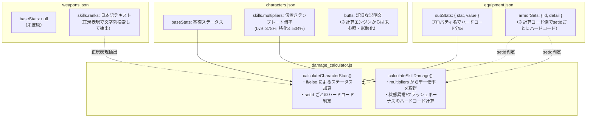
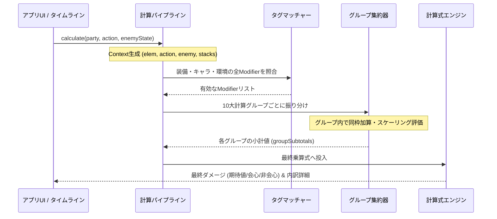

# エンドフィールド攻略計算ツール：計算システム・データ構造再設計仕様書
**文書種別**: アーキテクチャ設計書 / データモデル仕様書  
**作成日**: 2026年11月8日  
**ステータス**: ドラフト（設計提案）  
**対象コンポーネント**: `damage_calculator.js`, `app.js`, `data/*.json`, `schemas/*.json`

---

## 1. 背景と目的

### 1.1 背景
現在エンドフィールド攻略ツールでは、キャラクター・武器・防具のステータス計算、スキル倍率、およびダメージ計算が行われています。しかし、ゲーム仕様が複雑化（アーツ付着・反応・状態異常・クラッシュ段階消費・多段追撃など）するにつれ、**「データ側の定義」と「計算コード（`damage_calculator.js`）」の間でハードコードや二重管理が多数発生**しています。

特に以下の課題が顕著です：
1. **スキル倍率の画一化**: 全キャラ共通のテンプレート値で上書きされ、固有倍率や多段・条件追加倍率が反映されない。
2. **バフのハードコード**: `data/characters.json` 内の `buffs` 配列が計算エンジンから参照されず、防具セット効果や状態異常ボーナスが計算機コード内に `if (setId === 'set_volcano')` のようにベタ書きされている。
3. **拡張性の欠如**: 新しい装備、新スキル、料理バフ、凸効果を追加するたびに、計算エンジンのソースコードを直接改修しなければならない。

### 1.2 目的
これらを根本解決するため、**「値にタグ（Tag）を付与し、タグをもとに計算グループ（Calculation Group）へ自動集約するアーキテクチャ」**を導入します。

---

## 2. 現行システムの管理方法と課題分析（AS-IS）

### 2.1 現行のデータ管理状況
現在、アプリ内ではステータス、スキル倍率、バフがそれぞれ異なる形式・場所でバラバラに管理されています。



### 2.2 現行の詳細な問題点

| 対象 | 現行の管理方法 | 発生している問題・限界 |
| :--- | :--- | :--- |
| **基礎ステータス** | `characters.json` の `baseStats`<br>`weapons.json` の `baseStats` | 武器の `baseStats` が `null` のため、計算エンジン側で正規表現パースを試みるなど泥臭い処理が発生している。 |
| **装備サブステータス** | `equipment.json` の `subStats`<br>`[{ stat: 'atkPercent', value: 0.123 }]` | `stat` の文字列（`atkPercent`, `physicalDamageUp`, `allSkillDamageUp` 等）を `calculateCharacterStats` 内の巨大な `if/else` で手動仕分けしている。 |
| **スキル倍率** | `characters.json` の `skills[].multipliers`<br>`{ lv9: 3.78, lv12_spec3: 5.04 }` | 単一の数値しか持てないため、多段ヒット、派生攻撃、特定条件下での追加倍率（例: 猛撃時の追加倍率、源石結晶消費倍率）が表現できず、一律テンプレートで上書きされている。 |
| **スキルバフ・効果** | `characters.json` の `buffs` 配列 | 説明文（`description`）が書かれているだけで、計算エンジン（`damage_calculator.js`）からは一切参照されていない（UI表示専用の飾りになっている）。 |
| **防具セット効果** | `equipment.json` の `armorSets` | `damage_calculator.js` 内に `if (stats.setId === 'set_volcano') ... else if (stats.setId === 'set_kyuho') ...` と直接コードに条件が書き込まれているため、セットを追加・変更するたびにJSコードを修正する必要がある。 |

---

## 3. 新アーキテクチャの基本設計（TO-BE: タグ＆計算グループ方式）

### 3.1 コアコンセプト
すべての効果値・補正値を**「モディファイア（Modifier）」**として統一し、モディファイアに**「タグ（Tag）」**を付与します。  
計算エンジンは、現在の実行文脈（Context）に合致するタグを持つモディファイアを抽出し、**「計算グループ（Calculation Group）」**へ自動集約してダメージを算出します。

```mermaid
flowchart LR
    subgraph データソース群（すべてタグ付きモディファイアを持つ）
        D1[キャラ基礎・素質・潜在]
        D2[武器基礎・武器スキル]
        D3[防具ステ・セット効果]
        D4[状態異常・アーツ反応]
        D5[料理・外部バフ]
    end

    subgraph タグマッチャー（Tag Matcher）
        Filter["コンテキスト判定<br>（属性: 物理 / 技: 戦技 / 敵: 燃焼中）"]
    end

    subgraph 計算グループ（10大枠）
        G1["① 参照スケール（攻撃力）"]
        G2["② スキル倍率枠"]
        G3["③ ダメージUP枠"]
        G4["④ 増幅枠"]
        G5["⑤ 被ダメージUP枠"]
        G6["⑥ 脆弱枠"]
        G7["⑦ 耐性補正枠"]
        G8["⑧ 防御補正枠"]
        G9["⑨ 会心補正枠"]
        G10["⑩ ブレイク補正枠"]
    end

    subgraph 最終ダメージ算出
        Formula["ダメージ計算式<br>① × ② × ③ × ④ × ⑤ × ⑥ × ⑦ × ⑧ × ⑨ × ⑩"]
    end

    D1 & D2 & D3 & D4 & D5 --> Filter
    Filter --> G1 & G2 & G3 & G4 & G5 & G6 & G7 & G8 & G9 & G10
    G1 & G2 & G3 & G4 & G5 & G6 & G7 & G8 & G9 & G10 --> Formula
```

---

## 4. タグ設計（Tag Taxonomy）

モディファイアに付与するタグは、以下の5つの直交するディメンション（軸）で構成します。コロン区切りの階層構造（Namespace）を採用します。

### 4.1 タグの5大分類

| 分類 | プレフィックス | 説明 | タグの具体例 |
| :--- | :--- | :--- | :--- |
| **属性 (Element)** | `elem:` | 技やダメージの属性 | `elem:physical` (物理), `elem:heat` (灼熱), `elem:cryo` (寒冷), `elem:electric` (電磁), `elem:nature` (自然), `elem:arts` (全アーツ) |
| **攻撃種 (Action)** | `action:` | 攻撃・スキルの種類 | `action:normal` (通常), `action:skill` (戦技), `action:combo` (連携), `action:ult` (必殺), `action:all` (全スキル) |
| **発動条件 (Condition)** | `cond:` | バフが有効となる条件 | `cond:always` (常時), `cond:broken` (ブレイク時), `cond:combustion` (燃焼時), `cond:freeze` (凍結時), `cond:crush` (クラッシュ消費時) |
| **出所 (Source)** | `src:` | 値の由来 | `src:character`, `src:weapon`, `src:armor`, `src:armor_set`, `src:food`, `src:reaction` |
| **スケール型 (Type)** | `type:` | 補正の掛かり方 | `type:flat` (固定加算), `type:percent` (比率加算), `type:multiplier` (乗算倍率) |

---

## 5. 計算グループ定義（Calculation Groups: 10大枠）

Wikiruおよび検証レポートで確定した10大計算グループです。各モディファイアは、集約先となる `calcGroup` を指定します。

| グループID | グループ名称 | 集約ルール | 該当するタグ・効果の例 |
| :--- | :--- | :---: | :--- |
| `reference_scale` | ① 参照スケール（攻撃力） | 同枠加算<br>→ 能力値乗算 | 基礎攻撃力、攻撃力%、固定攻撃力、筋力/敏捷/知性/意志 |
| `skill_multiplier` | ② ダメージ倍率補正 | モーション合算<br>＋ 条件追加加算 | スキル基礎倍率、多段ヒット倍率、猛撃追加倍率、源石結晶消費倍率 |
| `damage_up` | ③ ダメージUP補正 | 同枠加算 | 物理ダメージUP%、灼熱ダメージUP%、戦技ダメージUP%、与ダメUP% |
| `amplification` | ④ 増幅補正 | 同枠加算<br>（他枠と独立乗算） | 電磁増幅%、灼熱増幅%、アーツ増幅% |
| `taken_damage_up` | ⑤ 被ダメージ補正 | 同枠加算<br>（他枠と独立乗算） | 敵被ダメージUP%（破砕異常、感電異常など） |
| `vulnerability` | ⑥ 脆弱補正 | 同枠加算<br>（他枠と独立乗算） | 物理脆弱%、アーツ脆弱%、クラッシュ段階脆弱 |
| `resistance` | ⑦ 耐性補正 | 減算<br>`1 - (耐性 - デバフ)` | 敵属性耐性%、腐食による全属性耐性ダウン% |
| `defense` | ⑧ 防御補正 | 軽減式<br>`100 / (100 + 防御)` | 敵防御力、防御力ダウンデバフ |
| `critical` | ⑨ 会心補正 | 期待値 / 会心時 | 会心率%、会心ダメージ% |
| `break` | ⑩ ブレイク補正 | 独立乗算 | ブレイク時倍率（基礎1.5倍 ＋ ブレイク強化%） |

---

## 6. 新データモデル仕様（スキーマ設計）

### 6.1 共通モディファイア構造体 (`Modifier`)
キャラ・武器・防具のすべての効果値を、以下の単一フォーマットで記述します。

```typescript
interface Modifier {
  id: string;               // 一意なモディファイアID (例: "mod_admin_skill_base")
  name: string;             // 表示用名称 (例: "構成配列 基礎倍率")
  calcGroup: CalcGroupId;   // 10大計算グループID
  value: number;            // 基準値 (Lv9や基準ランクの値。例: 2.80)
  valuesByRank?: {          // ランク/レベル別の数値テーブル (任意)
    [levelKey: string]: number; // 例: { "lv1": 1.56, "lv9": 2.80, "spec3": 3.50 }
  };
  tags: string[];           // 判定用タグ配列 (例: ["action:skill", "elem:physical", "cond:always"])
  scalingFormula?: string;  // 動的スケーリング式 (任意。例: "1.5 * (1 + crushStacks)")
}
```

### 6.2 キャラクタースキルモデル改定例
従来の単一 `multipliers` を廃止し、技を構成するモディファイアのリストを持たせます。

```json
{
  "id": "skill_admin_s1",
  "name": "構成配列",
  "shortName": "戦技",
  "damageType": "物理",
  "modifiers": [
    {
      "id": "admin_s1_base",
      "name": "戦技 基礎ダメージ",
      "calcGroup": "skill_multiplier",
      "value": 2.80,
      "valuesByRank": {
        "r1": 1.56,
        "r9": 2.80,
        "spec1": 3.00,
        "spec2": 3.25,
        "spec3": 3.50
      },
      "tags": ["action:skill", "elem:physical", "cond:always"]
    },
    {
      "id": "admin_s1_smash_bonus",
      "name": "猛撃追加ダメージ",
      "calcGroup": "skill_multiplier",
      "value": 1.50,
      "scalingFormula": "1.50 * (1 + context.crushStacks)",
      "tags": ["action:skill", "elem:physical", "cond:crush_consumed"]
    }
  ]
}
```

### 6.3 防具およびセット効果モデル改定例
防具のサブステータスやセット効果も、同じ `modifiers` 構造で定義します。

```json
{
  "id": "set_joryu",
  "name": "壌流",
  "threePieceModifiers": [
    {
      "id": "joryu_atk",
      "name": "壌流 攻撃力UP",
      "calcGroup": "reference_scale",
      "value": 0.10,
      "tags": ["type:percent", "cond:always"]
    },
    {
      "id": "joryu_elem_buff",
      "name": "壌流 電磁・自然ダメージUP",
      "calcGroup": "damage_up",
      "value": 0.15,
      "scalingFormula": "0.15 * context.consumedAnomalyStacks",
      "tags": ["elem:electric", "elem:nature", "cond:anomaly_consumed"]
    }
  ]
}
```

---

## 7. 計算エンジン（`damage_calculator.js`）の解決フロー

計算エンジンは、以下のパイプラインで動作します。



---

## 8. 本設計によるメリットと移行計画

### 8.1 期待されるメリット
1. **完全なデータ駆動（Data-Driven）化**:
   - 計算エンジン内の `if (setId === 'set_volcano')` や正規表現パースが**全廃**されます。
   - 新キャラ、新武器、新防具の追加が JSON データのみで完結します。
2. **多段・条件付きスキルの完全再現**:
   - ウルフガードの5回連射、管理人のクラッシュ消費猛撃、イヴォンヌの凍結時追加倍率などがすべて正確に計算されます。
3. **UI内訳表示の劇的進化**:
   - 「なぜこのダメージになったのか」を、各計算グループに集約されたタグ付きモディファイア一覧としてそのままユーザーに提示可能になります。

### 8.2 段階的移行ロードマップ
- **フェーズ1（データ変換）**:
  - `docs/skport_all_operators.json` および `docs/endfield_effects_master.csv` から、公式スキル倍率テーブルと固有追加倍率をパースして新スキーマの `modifiers` を生成。
- **フェーズ2（計算エンジン更新）**:
  - `damage_calculator.js` に `TagMatcher` と `GroupAggregator` を実装。後方互換性を保ちながら新パイプラインへ切り替え。
- **フェーズ3（UI連動）**:
  - タイムラインシミュレータおよび詳細内訳UIに、計算グループ別モディファイア内訳を表示。
