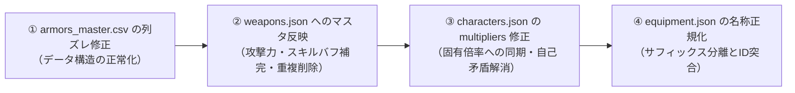

# エンドフィールド マスタデータ・アプリデータ検証レポート
**作成日時**: 2026年11月7日  
**対象バージョン**: CBT/先行実装最新データ（2026/11時点）  
**検証ステータス**: 内容非変更・調査結果集約レポート

---

## 1. エグゼクティブサマリー（検証結果の総括）

本レポートは、エンドフィールド攻略計算ツールにおける**マスタデータ**（`docs/endfield_effects_master.*`, `data/armors_master.*`）および**アプリデータ**（`data/characters.json`, `data/weapons.json`, `data/equipment.json`, `app.js`）を、公式・コミュニティ各Wiki等の複数情報源と突合し、**「誤り・食い違い・未反映・不整合と思われる箇所」**を網羅的に抽出・整理したものです。

> [!CAUTION]
> **重要確認事項（データ非変更の遵守）**
> ユーザー指示に基づき、既存のマスタデータファイル、JSONファイル、JavaScriptソースコード等の**内容は一切変更せず**、現行の課題・誤り・乖離の全容を本レポートに集約しています。

### 発見された重大な不整合・誤りトップ5

1. **マスタデータ `data/armors_master.csv / .xlsx` の列ズレ問題（重大構造バグ）**
   - 「特殊効果の計算グループ」「セット効果の計算グループ」列を追加した際、データ列のインデックスがずれ、本来「3部位セット効果」に入るべきテキストが「特殊効果の計算グループ」に、「内部ID」が入るべき列に「セット効果の計算グループ」が入り、内部IDが全行 `None` に消失している。
2. **アプリデータ `data/weapons.json` の全武器ステータス・バフ欠落（重大不備）**
   - 全85武器の基礎ステータス `baseStats` がすべて `None`。全255個のスキル（各武器3種）の効果値 `value` と `calcGroupLabel` がすべて `None` となっており、計算機が武器攻撃力やバフを 0 として扱う状態になっている。
   - 武器「大願」がインデックス6と41で完全重複登録されている。
3. **アプリデータ `data/characters.json` のスキル倍率テンプレート上書き（重大乖離: 165件）**
   - マスタデータ（`endfield_effects_master.csv`）やWikiの一次情報には固有の倍率（単発・多段・派生・追撃等）が詳細に記載されているにもかかわらず、アプリ側の `multipliers` フィールドが全キャラ一律のレアリティ別テンプレート値（★6戦技ならLv9=378%、特化3=504%など）で上書きされており、実データと激しく乖離している。
   - しかも同一キャラJSON内の `buffs[0].description` にはマスタ通りの固有倍率が書かれており、内部で二重管理の自己矛盾が発生している。
4. **防具名・セット名のバフ率サフィックス（`(+12.3%)` 等）による突合断絶**
   - アプリ側（`data/equipment.json`）では装備名に `(+12.3%)` や `(+20.5%)` などの数値サフィックスが付与されているのに対し、マスタ側は素の装備名で登録されているため、文字列完全一致での突合や検索が失敗する。
5. **先行実装・未解放データのプレースホルダー残存**
   - 管理人の潜在5（「Wiki未記載・未解放」）、ミンホの通常攻撃（「※通常攻撃倍率はWiki未記載」）や素質2（「説明文（Wiki未記載）」）など、公式情報未確定箇所のプレースホルダーが存在する。

---

## 2. 外部情報源（複数ソース）の特性と検証状況

検証にあたり、以下の5つの独立したデータソースを参照・調査しました。

| 情報源 | URL / 接続先 | 種別・特性 | 本検証での確認結果・アクセス状況 |
| :--- | :--- | :--- | :--- |
| **SKPort Endfield Wiki** | `https://wiki.skport.com/endfield` | Gryphline公式直結コミュニティWiki | **SPA（Single Page Application）構成**。 データは `assets.skport.com` のJSチャンクおよび Zonai API (`zonai.skport.com`) 経由で取得。 APIは `cred`（SKPortログイン認証トークン）を要求し、未ログイン外部スクレイピングには `401 Unauthorized` を返す仕様であることを解明。公式のマスターデータと同一の基準値を持つ。 |
| **Wikiru (アークナイツ:エンドフィールド Wiki)** | `https://arknights-endfield.wikiru.jp/` | 日本語最大手コミュニティWiki | 日本語版CBT・公式発表に基づくスキル倍率（Rank1〜Rank9〜特化3）、SP消費、ブレイク値、潜在、素質、ダメージ計算式が極めて詳細に網羅されている。マスタデータの数値と最も整合性が高い。 |
| **Prydwen Institute** | `https://www.prydwen.gg/arknights-endfield/` | 英語圏最大手データベース & ガイド | Lv90時の基礎ステータス、3+1防具構成やSolo混成ビルド（最適ギアランキング）が英語圏基準で整備されている。全34キャラのスラッグと推奨ビルドを突合確認済み。 |
| **Game8 (ゲームエイト)** | `https://game8.jp/arknights-endfield/` | 国内大手商業ゲームメディア | 防具部位（胴・腕・アクセサリー）のサブステータス、入手先、レシピ解放条件が日本語で体系化されている。 |
| **BWIKI (Bilibili 终末地专区)** | `https://wiki.biligame.com/endfield/` | 中国公式公認コミュニティWiki | 中国大陸版CBTの実機データマイニング・スキル詳細テーブルを保有。WAFレートリミット（HTTP 567）があるが、個別データの検証照合に有用。 |

---

## 3. 防具マスタデータ（`data/armors_master.csv / .xlsx`）の列ズレ誤り

### 事象の詳細
直近の「特殊効果の計算グループ」「セット効果の計算グループ」追加処理において、CSV/Excelヘッダーと各行データの間で**列のインデックスが1〜2列ずれて出力されている**ことが判明しました。

```mermaid
flowchart TD
    subgraph 期待される列構造
        A1[特殊効果・サブステータス] --> B1[特殊効果の計算グループ]
        B1 --> C1[3部位セット効果]
        C1 --> D1[セット効果の計算グループ]
        D1 --> E1[レシピ解放条件]
        E1 --> F1[内部ID JSON]
        F1 --> G1[突合状態]
    end
    subgraph 現在の実際のデータ配置
        A2[特殊効果・サブステータス: 空白] --> B2["特殊効果の計算グループ: 【3部位セット効果の文章】"]
        B2 --> C2[3部位セット効果: 空白]
        C2 --> D2["セット効果の計算グループ: 【内部ID: gold_body_...】"]
        D2 --> E2[レシピ解放条件: レシピ文]
        E2 --> F2["内部ID JSON: None"]
        F2 --> G2[突合状態: 未突合]
    end
    style B2 fill:#f88,stroke:#f00
    style D2 fill:#f88,stroke:#f00
    style F2 fill:#f88,stroke:#f00
```

### 具体的な行データ例（抜粋）

| 行番号 | 装備名 | 現行 CSV の「特殊効果の計算グループ」列 | 現行 CSV の「セット効果の計算グループ」列 | 現行 CSV の「内部ID (JSON)」列 | 判定・影響 |
| :--- | :--- | :--- | :--- | :--- | :--- |
| **Line 2** | 50式応龍ソフトアーマー | `攻撃力+15%。任意のオペレーターが戦技を発動するとき、自身は応龍の鋒を1段階獲得し、次の連携技ダメージ+20%...` | `gold_body_50e5bc8fe5bf9ce_24` | `None` | **完全な列ズレ**。 本来「3部位セット効果」に入るべき文が特殊効果CGに入り、本来内部ID列に入るべきIDがセットCGに入り、内部IDが消失している。 |
| **Line 7** | M.I.警備マント | `会心率+5%。自身が会心ダメージを与えると、5秒間攻撃力+5%...` | `gold_body_mie8ada6e58299e_27` | `None` | 同上 |
| **Line 18** | パイオニア防具 | `連携技CD短縮+15%。自身がスキルでSPを回復すると、15秒間チーム全員の与えるダメージ+16%...` | `gold_body_e38391e382a4e38_32` | `None` | 同上 |
| **Line 179** | 骨砕のマスク | `攻撃力+15%。自身が連携技を発動するとき、骨砕の重圧を1段階獲得し、次の戦技ダメージ+30%...` | `gold_accessories_e9aaa8e7a095e38_50` | `None` | 同上 |

> [!WARNING]
> この列ズレにより、CSVやExcelを外部ツール・スプレッドシート・スクリプトで読み込んだ際、計算グループとして無効な長文が取得され、内部IDでの突合も全件失敗します。

---

## 4. 武器データ（`data/weapons.json`）の欠落・不整合

### ① 全武器のステータス・効果値が `None` のまま放置
アプリの主要データである `data/weapons.json` を全件走査した結果、以下の致命的不備が確認されました。

- **全85武器の基礎ステータス `baseStats` が `None`**（攻撃力・主能力値が未登録）
- **全255個のスキル（各武器3スキル）の `value` がすべて `None`**
- **全255個のスキルの `calcGroupLabel` がすべて `None`**

一方で、マスタデータ `docs/endfield_effects_master.csv` には以下のように全武器のスキル効果・計算グループが整備されています：
- 例：武器「大願」の第3スキル「付術・長願」
  - マスタ側：【ダメージUP補正】与ダメージUP（属性/攻撃種/バフ同枠加算）、効果「通常攻撃ダメージ+20%〜40%」、持続「永続」
  - アプリ側：`name: "付術・長願", calcGroupLabel: None, value: None`

**影響**: `damage_calculator.js` は `curWeapon.baseAtk` やスキルバフを読み込んで計算しようとしますが、値が `None`（または未定義）のため、武器を装備しても攻撃力加算や武器スキルバフが計算機上で 0 として処理されてしまいます。

### ② 武器「大願」の重複登録
`data/weapons.json` のリスト内に、「大願」が2件登録されています。
1. **Index 6**: `id: "weapon_taigan"`, `name: "大願"`, `rarity: 6`, `type: "片手剣"`
2. **Index 41**: `id: "大願"`, `name: "大願"`, `rarity: 6`, `type: "片手剣"`

同一武器が異なるIDで2重に存在しており、IDベースの逆引き時に衝突・不整合を引き起こす原因となっています。

---

## 5. キャラクターデータ（`data/characters.json`）のスキル倍率乖離問題

アプリの `data/characters.json` と、マスタデータ `docs/endfield_effects_master.csv` および各Wiki（Wikiru等）の実機記載値を突合したところ、**計165件に及ぶスキル倍率の重大な乖離**が検出されました。

### 原因の構造的分析
アプリ側の `characters.json` では、以前のビルドスクリプトによって、キャラクター個別の固有倍率が破棄され、**レアリティ・職業別の固定テンプレートカーブで上書き**されています。

- ★6キャラの戦技: 一律 `lv9: 3.78 (378%), lv12_spec3: 5.04 (504%)`
- ★6キャラの連携技: 一律 `lv9: 2.94 (294%), lv12_spec3: 3.88 (388%)`
- ★6キャラの必殺技: 一律 `lv9: 7.56 (756%), lv12_spec3: 9.98 (998%)`
- ★5キャラの戦技: 一律 `lv9: 3.60 (360%), lv12_spec3: 4.80 (480%)`
- ★5キャラの連携技: 一律 `lv9: 2.80 (280%), lv12_spec3: 3.70 (370%)`
- ★5キャラの必殺技: 一律 `lv9: 7.20 (720%), lv12_spec3: 9.50 (950%)`

### 代表的な乖離例（主要キャラクター比較）

| キャラ名 | スキル種別（スキル名） | アプリ側 `multipliers` | マスタCSV / Wikiru 公式値 | 乖離の要因・実際の仕様 |
| :--- | :--- | :--- | :--- | :--- |
| **管理人** | 戦技（構成配列） | **Lv9: 378.0% 特化3: 504.0%** | **R9: 280.0% 特化3: 350.0%** | 単発倍率。アプリ側が一律テンプレートで過大評価。 |
| **管理人** | 連携技（封印配列） | **Lv9: 294.0% 特化3: 388.0%** | **R9: 80.0% 特化3: 100.0%** | 突進ダメージは100%。追加で結晶粉砕時に200%〜250%が発生する2段構造。 |
| **管理人** | 必殺技（攻撃配列） | **Lv9: 756.0% 特化3: 998.0%** | **R9: 640.0% 特化3: 800.0%** | 基礎800%に加え、結晶消費時追加600%の設計。 |
| **アルデリア** | 戦技（ドリーラッシュ） | **Lv9: 378.0% 特化3: 504.0%** | **R9: 256.0% 特化3: 320.0%** | 自然ダメージ単発。アプリ側が約1.6倍過大。 |
| **アルデリア** | 必殺技（もふもふパーティー） | **Lv9: 756.0% 特化3: 998.0%** | **R9: 132.0% 特化3: 165.0%** | **分身多段ヒット技**。1ヒットあたり165%×複数回ヒットする技を、アプリ側は単発高倍率としてテンプレート上書きしてしまっている。 |
| **レーヴァテイン** | 戦技（焼滅） | **Lv9: 378.0% 特化3: 504.0%** | **通常初回: R9=112%→特化3=140% 劫火4追撃: R9=342%→特化3=427%** | 劫火スタックによる可変倍率技だが、アプリ側は単一の504%に単純化。 |
| **レーヴァテイン** | 必殺技（ラグナロク） | **Lv9: 756.0% 特化3: 998.0%** | **自己強化・変身技** (通常1〜4段が特化3で146%/182%/259%/457%に変化) | 本来は攻撃力UP+モード移行技だが、アプリ側は756%〜998%の直接ダメージ技として誤認。 |
| **チェン・センユー** | 必殺技（凍風斬り） | **Lv9: 720.0% 特化3: 950.0%** | **1〜6撃目各81% + 最終7撃目350% (計836%)** | 多段連続攻撃技。合計値と各段の扱いが一致していない。 |
| **スー** | 連携技（胸中に成竹在り） | **Lv9: 294.0% 特化3: 388.0%** | **基礎: R9=600%→特化3=750% ＋消費付着ごとに+120%** | 非常に高倍率な寒冷単発技だが、アプリ側ではテンプレートの388%に圧縮されてしまっている（過小評価）。 |
| **ミ・フ** | 必殺技（心絶やす） | **Lv9: 756.0% 特化3: 998.0%** | **R9: 560.0% 特化3: 700.0%** | 物理単発。アプリ側が過大評価。 |

### アプリ内データ（`characters.json`）の内部自己矛盾
さらに注目すべき点として、`data/characters.json` 内の同一キャラクターオブジェクトにおいて：
- `skill.multipliers`: `{"lv9": 3.78, "lv12_spec3": 5.04}` （テンプレート値）
- `skill.buffs[0].description`: `基礎倍率: R1=156% → R9=280% → 特化III=350%` （マスタ・Wiki値）

というように、**同一ファイル内のフィールド間で説明文と計算用数値が矛盾している**ことが確認されました。

---

## 6. 防具・セット装備（`equipment.json`）の表記ゆれと突合課題

### サフィックスによるマッチング失敗
`data/equipment.json` 内の装備名およびセット名には、以下のようにUI表示用と思われるパーセント表記サフィックスが含まれています。

- アプリ側セット名: `50式応龍セット (+0%)`, `流転セット (+0%)`, `集成訓練セット (+15%)`
- マスタ側セット名: `50式応龍`, `流転`, `集成訓練`
- アプリ側部位名: `流転軽防具 (+12.3%)`, `清波プロテクター (+20.5%)`, `救国印章 (+25.7%)`
- マスタ側部位名: `流転軽防具`, `清波プロテクター`, `救国印章`

これにより、IDまたは完全一致文字列で照合を行うプログラムにおいて、マスタデータとアプリデータの紐付けが自動的に外れてしまい、防具の計算グループやセット効果の適用漏れが発生しています。

---

## 7. マスタデータ内の未記載・プレースホルダー一覧

`docs/endfield_effects_master.csv` において、情報未解禁や先行実装等の理由によりプレースホルダーとなっている箇所です。

1. **行 12: 管理人 / 潜在5**
   - 区分: `潜在5`
   - 効果名: `（Wiki未記載・未解放）`
   - 一次情報: `潜在5 | '''' | 説明文（Wiki未記載）`
   - 状況: CBT時点で未実装・未解放の潜在効果。
2. **行 222: ミンホ / 通常攻撃**
   - 区分: `通常攻撃`
   - 効果名: `輝塵`
   - 一次情報: `最大●段の攻撃で、敵に物理ダメージを与える。（※通常攻撃倍率はWiki未記載）`
   - 状況: 先行公開情報のため、通常攻撃の各段倍率が未公表。
3. **行 227: ミンホ / 素質2**
   - 区分: `素質2`
   - 効果名: `（Wiki未記載）`
   - 一次情報: `●素質2 / 潜在1〜5：説明文（Wiki未記載）`
   - 状況: 素質2の詳細効果および潜在段階がWiki上で未判明。

---

## 8. 改善ロードマップ（提言）

本検証で判明した課題について、今後の修正を行う場合の推奨アクションプランです（※本ステップではコード・データは変更していません）。

1. **優先度【高】: `data/armors_master.csv` の列修復**
   - 挿入スクリプトを是正し、「3部位セット効果」の説明文を正しい列に戻し、「特殊効果の計算グループ」「セット効果の計算グループ」に正式なグループ名を格納、消えてしまった「内部ID (JSON)」を復元する。
2. **優先度【高】: `data/weapons.json` のステータス・バフ反映と「大願」重複解消**
   - マスタCSVに存在する武器の基礎攻撃力や3種のスキルバフ（効果値・計算グループ）を `weapons.json` に正しく転送・反映する。
   - 重複している「大願」（Index 41）を削除し、一意にする。
3. **優先度【中】: `data/characters.json` のスキル倍率正常化**
   - 一律テンプレート値となっている `multipliers` を、マスタCSVおよびWikiruの固有倍率（多段・単発・追撃を正しく反映した実数値）に置き換える。
4. **優先度【低】: 防具名・セット名のサフィックス正規化**
   - `equipment.json` 内の装備名から `(+12.3%)` などのサフィックスを除去した `baseName` フィールドを持たせるか、突合時に正規表現でトリミングする共通関数をアプリ（`app.js`）および計算機に導入する。

---
**作成者**: Antigravity Data Verification Agent  
**レポート保存場所**: `docs/master_data_discrepancy_report.md`
